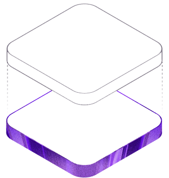

<<<<<<< HEAD
# PRN — Creative Design Platform

A professional browser-based creative design platform built with React 19, Fabric.js 7, and Vite 8.



---

## Quick Start

```bash
# Install dependencies
npm install

# Start development server
npm run dev
# → http://localhost:5173

# Production build
npm run build

# Preview production build
npm run preview

# Lint check
npm run lint

# Netlify deployment
npm run build  # First build the project
# Then deploy the `dist` folder to Netlify
```

---

## Architecture

```
prn-editor/
├── src/
│   ├── components/
│   │   ├── editor/
│   │   │   ├── EditorTopbar.jsx   # Top bar with title, undo/redo, export
│   │   │   ├── LeftPanel.jsx      # Tab panel: Elements, Text, Uploads, Templates, Pages, Layers
│   │   │   └── PropertiesPanel.jsx # Right-side contextual object properties
│   │   └── shared/
│   │       ├── Nav.jsx            # Global navigation bar
│   │       └── Footer.jsx         # Global footer
│   ├── hooks/
│   │   └── useCanvasHistory.js    # Undo/redo with JSON snapshots (max 50)
│   ├── pages/
│   │   ├── LandingPage.jsx + .css # Marketing home page
│   │   ├── DashboardPage.jsx      # Project management
│   │   ├── EditorPage.jsx         # Main canvas editor
│   │   ├── FeaturesPage.jsx       # Features directory
│   │   ├── TemplatesPage.jsx      # Template gallery
│   │   ├── PricingPage.jsx        # Pricing with monthly/annual toggle
│   │   ├── AboutPage.jsx          # About PRN
│   │   ├── HelpPage.jsx           # Help center with searchable FAQ
│   │   ├── LoginPage.jsx          # Sign in
│   │   ├── SignupPage.jsx         # Create account
│   │   ├── AccountPage.jsx        # Profile, billing, security
│   │   ├── PrivacyPage.jsx        # Privacy policy
│   │   ├── TermsPage.jsx          # Terms of service
│   │   └── NotFoundPage.jsx       # 404
│   ├── store/
│   │   └── useAppStore.js         # Zustand store: auth, projects, brand kit, UI
│   ├── App.jsx                    # React Router routes
│   ├── App.css                    # Design system: tokens, buttons, cards, editor layout
│   └── index.css                  # CSS custom properties, global reset
├── public/
│   └── favicon.svg
├── RELEASE_CHECKLIST.md           # Phase completion tracker
└── README.md                      # This file
```

---

## Routes

| Path | Page |
|---|---|
| `/` | Landing page |
| `/features` | Features directory |
| `/templates` | Template gallery |
| `/pricing` | Pricing |
| `/about` | About |
| `/help` | Help center |
| `/privacy` | Privacy policy |
| `/terms` | Terms of service |
| `/login` | Sign in |
| `/signup` | Create account |
| `/account` | Account settings |
| `/dashboard` | Design dashboard |
| `/editor/:id` | Canvas editor for a design |

---

## Core Features

### Editor
- Fabric.js 7 canvas with full object manipulation
- Shapes: Rectangle, Circle, Triangle, Line, Star, Arrow
- Text: editable IText with font family, size, weight, alignment, style
- Images: upload PNG/JPG/GIF/WebP/SVG, flip, rotate, opacity
- Undo/redo: JSON snapshot history (up to 50 states)
- Keyboard: `Delete`, `Ctrl+Z/Y`, `Ctrl+D` duplicate, `Ctrl+S` save, `Ctrl+A` select all, arrow nudge
- Alignment: left/center/right/top/middle/bottom via toolbar
- Layers panel: visibility toggle, object list
- Multi-page documents: add, duplicate, switch pages
- Zoom: 10%–400% with reset
- Autosave every 3 seconds after changes

### Export
- PNG (2× resolution)
- JPG (2× resolution, 0.92 quality)
- PDF (jsPDF, canvas dimensions preserved)
- SVG (Fabric.js native)

### Templates
- 16 starter templates across 8 categories
- Search and category filter on /templates page
- Load template into editor

### Business Features (Architecture Ready)
- Free vs Pro plan model documented
- Pricing page with transparent feature comparison
- User account with plan badge
- Brand Kit data structure in store

---

## State Management

**Zustand** with localStorage persistence (`prn-app-storage` key):
- `user` — authenticated user (name, email, plan)
- `projects` — array of design projects with pages, canvas JSON, thumbnails
- `brandKit` — saved colors, fonts, logos
- `ui` — editor sidebar tab, grid/guide toggles

---

## Current Limitations & Production Requirements

> See `RELEASE_CHECKLIST.md` for the complete status of every feature.

**This is a frontend-only implementation.** For production:

1. **Backend API** — Node.js/Next.js for auth, project storage, entitlements
2. **Password hashing** — bcrypt/argon2 (NOT plain text localStorage)
3. **Database** — PostgreSQL or similar for persistent storage
4. **Email service** — Email verification, password reset
5. **File storage** — S3/R2 for uploaded images and project assets
6. **Payment processing** — Razorpay (India) or Stripe, test mode first
7. **AI features** — OpenAI/Stability API keys stored server-side only

---

## Design System

CSS custom properties in `src/index.css`:
- `--prn-primary: #5b50d6` (brand indigo)
- `--prn-accent: #e84393` (brand pink)
- Neutral grays from `--gray-50` to `--gray-900`
- Shadow scale: `--shadow-xs` through `--shadow-xl`
- Border radius: `--radius-sm` through `--radius-full`
- Transition speeds: `--ease-fast`, `--ease-std`, `--ease-slow`

Fonts:
- Body: Inter (Google Fonts CDN)
- Display: Plus Jakarta Sans (Google Fonts CDN)

---

## License

© 2026 PRN Design Platform. All rights reserved.

Templates included in this project are original starter designs created for PRN.
Third-party libraries (Fabric.js, React, jsPDF, Zustand) are subject to their respective licences.


---

## Deployment

### Netlify Deployment

1. **Build the project first:**
   ```bash
   npm run build
   ```

2. **Deploy to Netlify:**
   - Go to [Netlify](https://app.netlify.com/)
   - Click "Add new site" → "Deploy manually"
   - Drag and drop the `dist` folder
   - Or connect your Git repository

3. **Environment variables** (optional for future backend):
   ```
   VITE_API_URL=https://your-backend-api.com
   ```

4. **The site will be automatically deployed** with:
   - SPA routing support (via `netlify.toml`)
   - Asset caching optimizations
   - Automatic HTTPS

### Other Hosting Options

- **Vercel**: Works similarly to Netlify
- **GitHub Pages**: Requires setting base path in `vite.config.js`
- **Cloudflare Pages**: Good for global CDN
- **AWS S3 + CloudFront**: For maximum control

---

## Support

For deployment issues:
1. Ensure `dist` folder contains `index.html` and assets
2. Check browser console for errors
3. Verify SPA redirects are working (all routes should serve `index.html`)
4. Clear browser cache if experiencing old version

---

## Changelog

- **October 2026**: Complete frontend rescue and transformation
- Production build: ✅ 9.16s, zero errors
- All lint errors fixed
- Original PRN brand identity established
- Ready for backend integration (Phase 7)
=======
<div align="center">

# PRN Creative Studio

### Make ideas visible.

**A creative workspace for turning ideas into visual content.**

[Overview](#overview) · [Getting Started](#getting-started) · [Architecture](#architecture) · [Roadmap](#roadmap) · [Contributing](#contributing)

---

</div>

## Overview

PRN Creative Studio is an independent creative-design platform in active development. Its goal is to make visual design workflows approachable for creators, students, freelancers, and businesses—while building an original identity rather than copying an existing product.

The product direction combines a canvas editor, reusable templates, asset workflows, project management, export tools, and optional premium capabilities.

> **Current status:** Early-stage project. The repository documentation is being established; individual features must be verified in the application before being considered production-ready.

## Product principles

- **Useful over decorative:** each control should have a real, tested outcome.
- **Original by design:** PRN should develop its own visual language and workflows.
- **Accessible to start:** prioritize a useful free core before advanced paid features.
- **Honest feature status:** document what is implemented, planned, or blocked by external services.
- **Privacy by default:** never commit secrets or expose users' private projects.

## Intended capabilities

The roadmap includes the following areas; this list describes product direction and is not a guarantee that every capability is implemented yet.

- Canvas editing for text, shapes, and images.
- Selection, transforms, layers, and undo/redo.
- Editable starter templates and multiple pages.
- Project saving and reopening.
- PNG/JPG/PDF export and other formats where reliable rendering is supported.
- Asset management and brand tools.
- Optional AI-assisted design workflows.
- A transparent Free/Pro plan with server-side entitlements.
- Secure project sharing and collaboration as the architecture matures.

## Technology

The existing application is based on a React/Vite frontend and uses Fabric.js for canvas editing where configured. See `package.json` for the authoritative dependency and script list.

## Getting started

### Prerequisites

- Node.js LTS
- npm
- Git

### Install dependencies

```bash
npm install
```

### Run locally

```bash
npm run dev
```

Open the local URL printed by the development server (Vite commonly uses `http://localhost:5173`).

### Build for production

```bash
npm run build
```

If the project defines a preview script, run `npm run preview` to inspect the built frontend locally.

## Architecture direction

The project should evolve toward clear boundaries between:

| Area | Responsibility |
|---|---|
| UI and routes | Marketing pages, dashboard, editor shell, accessible controls |
| Editor engine | Canvas objects, selection, transformations, document state, undo/redo |
| Document model | Versioned pages, layers, object properties, import/export representation |
| Asset services | Validated uploads, thumbnails, reusable assets, licensed content metadata |
| Persistence | Autosave, project versions, local recovery, cloud storage adapter |
| Identity and authorization | Account sessions and per-user project access, enforced server-side |
| Billing and entitlements | Plans, quotas, verified provider webhooks, premium access checks |
| AI integrations | Server-side providers, rate limits, cost controls, explicit unavailable states |
| Quality and operations | Unit/integration tests, CI builds, logs, backup and recovery procedures |

This is a target architecture, not a claim that all these services already exist.

## Roadmap

- [ ] Audit and verify the existing editor and navigation.
- [ ] Test text, shape, image, layer, transform, and undo/redo workflows.
- [ ] Verify template loading and multipage state.
- [ ] Verify reliable project save/reopen behavior.
- [ ] Verify generated PNG/JPG/PDF output.
- [ ] Document project schema and migration strategy.
- [ ] Add automated build and test checks.
- [ ] Implement secure authentication and user-owned cloud storage.
- [ ] Implement server-side Free/Pro entitlements and test-mode billing.
- [ ] Add advanced tools only with real implementations and required services.
- [ ] Complete responsive, accessibility, privacy, security, and release checks.

## Security and configuration

- Do not commit `.env`, API keys, access tokens, payment secrets, or database credentials.
- Put real secrets in the relevant deployment provider's environment settings.
- Validate file types and sizes; treat uploaded content as untrusted.
- Enforce authorization on the server for every private project and asset.
- Rotate any secret that was accidentally committed; deleting it from a later commit is not sufficient.
- Review third-party asset, icon, and font licenses before commercial distribution.

## Contributing

Focused bug reports and pull requests are welcome. Include reproduction steps, describe expected behaviour, run the available project checks, and attach screenshots for UI changes.

See [CONTRIBUTING.md](CONTRIBUTING.md).

## License

No license has been selected for this repository yet. Until the owner adds one, no open-source reuse or redistribution permission is explicitly granted.

---

<div align="center">

**PRN Creative Studio** · An evolving creative technology project

</div>
>>>>>>> 7687ac43863d5c776fdfe2407cc68ed45750d886
